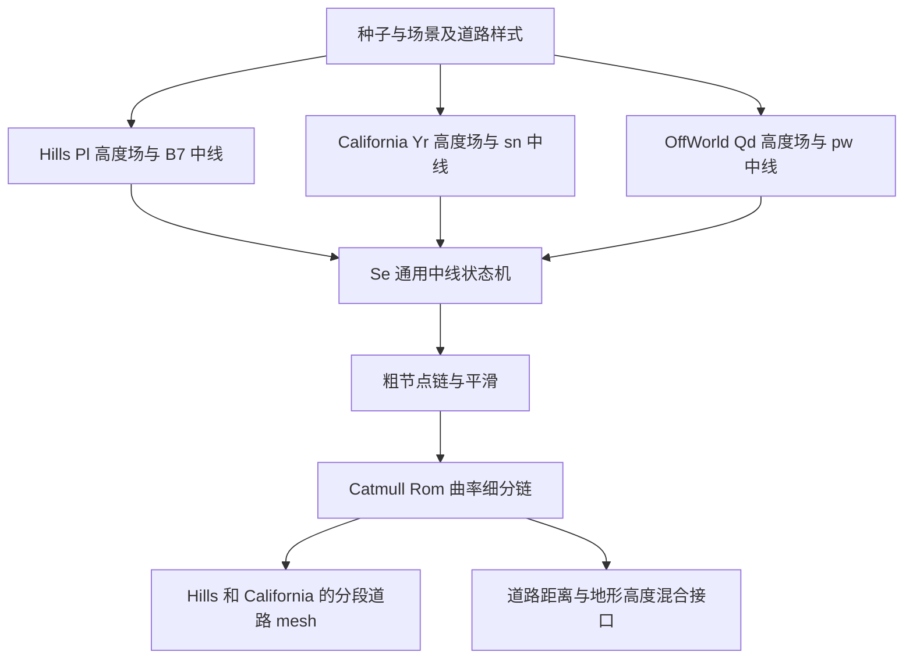

# Slow Roads 道路生成逆向对照报告

分析日期：2026 年 10 月 27 日。原游戏样本：本地 Electron 包 `slowroads`，`package.json` 版本 `1.0.2`。Unity 项目：`6000.3.22f1`，URP `17.0.1`。

**结论：当前 Unity 版复用了前方左右高度探测的初始转向公式，以及双顶点带状网格的基本拓扑，但尚未还原原版的完整道路生成算法。** 高度场、全局行进目标、坡度约束、回退寻路、桥梁状态、节点连接、后续平滑、曲率细分、道路宽度、UV 与分段生命周期均有实质差异。继续只调整现有几个参数，无法得到同种子、同路径的原版结果。

范围包括道路生成输入、中心路径、道路几何与流式管理；地形只分析影响道路的高度函数及贴合接口。车辆、光照、材质、植被绘制与完整地形 mesh 不在本轮范围内。桥梁的选址和路径高度属于道路算法，予以保留；桥墩、桥拱等附属网格不展开。附带分析文档作为待核对材料，未将其中的操作性文字作为指令。

## 1 源码基准与证据位置

### 1.1 必须使用正确的解包副本

原目录同时存在 `extracted` 与 `extracted_correct`。旧版 `asar_extract.js` 按文件相对偏移直接读取 archive，遗漏 `dataStart = 8 + headerLength`；`asar_extract_fixed.js` 修正了这一点。因此旧副本会从错误位置读出同长度内容，出现其他模块混入、文件尾截断等问题。

本次直接解析 `resources/app.asar` 的目录并读取数据区，对以下六个文件逐字节比对：**六个 `extracted_correct` 文件全部一致，六个 `extracted` 文件全部不一致**。不能将旧副本中的类名、行号和截断内容继续作为依据。完整 SHA256 见[验证结果][Verification]。

| 原文件 | 字节数 | 本轮作用 |
|---|---:|---|
| `DevMidlineGenerator.6316d1a7.js` | 54,705 | 高度场基类、通用中线生成器 `Se`、道路段基类 `D` |
| `HillsHeightmap.2938f21e.js` | 171,634 | Hills 高度场 `Pl`、道路样式与宽度、道路段派生类 `Nl`、道路与地形的高度混合 |
| `CaliMidlineGenerator.98e60041.js` | 212,075 | California 高度场 `Yr`、中线派生类 `sn`、道路段 `Ds` 与配置 |
| `SettingsManager.9657445f.js` | 800,404 | Hills 中线派生类 `B7`、道路控制器 `xi`、Hills 场景装配 |
| `normals.d4d92770.js` | 1,317,492 | Three.js 向心 Catmull–Rom 实现、公共状态、道路抬升常量 |
| `2.c189d18b.js` | 644,397 | California 场景装配、OffWorld 中线与高度场 |

正确目录中四个相关 `.pretty.js` 与各自原 `.js` 去除空白后内容相同，并通过 `node --check`；以下为便于阅读引用其行号。压缩文件中的 `D/Se/Pl/B7/xi` 是此构建产物的符号名，不推定为开发期类名。

| 代号 | 位置与主要函数 |
|---|---|
| D | [DevMidlineGenerator][Dev]：`D` 419–490；默认配置 499–500；`Se` 510–837；`extendFine` 700；`extendMidline` 709；平滑 801–836 |
| H | [HillsHeightmap][Hills]：道路样式 1052；宽度 1093；`Nl` 3664；配置装配 4606；高度混合 4649；`Pl` 4881 |
| C | [CaliMidlineGenerator][Cali]：道路样式 250；`Ds` 4537；宽度 5487；`Yr` 5563；`sn` 5789 |
| S | [SettingsManager 原始文件][Settings]：`B7` 从 UTF-16 字符偏移 700617 开始；`smoothHeight` 706000；`xi` 用 `let Y2=30,tt,T4;class xi` 搜索定位；`Ni.initialise/initRoad` 为 Hills 装配入口 |
| N | [向心曲线实现][Curve]：`yd` 10970，`OE` 10986；原始文件导出 `OE as dU`、`r_ as dT`，其中 `r_=.02` |
| W | [场景模块][World]：`pw` 597；OffWorld 样式 1476；`Qd` 1612；OffWorld 装配 2072；California 装配 3344 |
| U1 | [RoadMidline.cs][U1]：`RoadNode` 7；`RoadGenConfig` 23；`Step` 99；起始朝向 181 |
| U2 | [SlowRoadsRoad.cs][U2]：`Awake` 59；起点 76；历史查询 97；预热 114；流式 127；采样 160；mesh 191 |
| U3 | [NoiseHeightmap.cs][U3]：高度场与哈希；[SlowRoadsDemo.cs][U4]：初始化顺序 |
| U4 | [GrassRenderer.cs][Grass]：仅核对 `prewarmNodes=600` 与 117 行 `road.Prewarm`；未分析植被绘制 |

### 1.2 原版存在三个道路输入分支



Hills 实际链路为 `Ni → B7 → Se`，高度场传入 `Pl`；California 为 `vM → sn → Se`，高度场传入 `Yr`。**不能因为通用模块中存在 `ze` 梯度噪声，就认定 Hills 使用 `ze` 作为道路寻径高度场。** OffWorld 的 `pw/Qd` 也是另一分支；它的装配入口没有 Hills/California 的 `initRoad → xi`，道路几何通过地形系统的道路混合接口处理，不能把独立 `D` 带状 mesh 泛化到所有场景。[S、H、C、W]

## 2 逐项还原差异清单

下表中“缺失”指 Unity 当前道路代码没有对应行为，“替代”指存在不同算法，“部分”指仅部分公式或结构相同。编号用于后续逐项安排还原；参数数值另列于第 3 节。

### 2.1 高度输入和初始化

| 编号 | 原版行为 | Unity 当前行为 | 状态及具体影响 |
|---|---|---|---|
| R01 | Hills `Pl` 在 tile 内生成多层随机高度控制点，以有限支撑径向核叠加高度 | 整数格点哈希的 fBm 值噪声 | 替代。频谱、山谷、坡度、等高线位置都不同；路径输入首先就不相同 |
| R02 | Alea 以 `seed#layer#tileX#tileZ` 初始化，tile 连续查询相邻 tile；有缓存及裁剪 | 自定义整数 Hash；层种子 `seed+i*1013`；无 tile 或缓存 | 替代。同名种子没有对应的随机序列和空间布局 |
| R03 | `layerResolutions` 可非单调；有 `squared` 高度分布变换、`depthHeightFactor`、`temper` 和 tile 幅度随机 | 固定倍频 2、衰减 .5，5 层归一化相加 | 缺失。不能只调整 amplitude/baseScale 便视为等价 |
| R04 | spiralise 路径跨区域时推进高度场 layer；支持回退时撤销尾部层切换 | 高度函数在整个运行期间固定 | 缺失。长距离路线及后续地形重生成缺少共同状态 |
| R05 | 通用生成器支持指定起点、指定方向、起始海拔上下界、重试与重启；环形模式围绕目标半径选择位置 | 在 `[-300,300]²` 用 Unity 全局 Random 尝试 200 次，仅要求 `H>minElev+5`；最后一次即使失败仍接受 | 替代。起点分布与失败处理不同，固定 seed 也不固定起点 |
| R06 | 通用起始方向用周围约 10 单位的三个高度样本求局部等高线方向，也支持显式 heading | 四点中心差分，偏移 ±2，取梯度的垂线 | 替代。两者都与等高线相关，但离散估计、尺度及方向选择不同 |
| R07 | 场景合并道路样式、高度图配置与世界种子后初始化生成器 | `RoadGenConfig` 一套默认值；Demo `AddComponent` 后才赋 `road.seed` | 缺失且有初始化顺序问题。活动对象的 `Awake` 创建高度图时可能已使用字段默认 1337；见第 4 节 |

依据：D 14–187、593–700；H 4881–4945；S `Ni.initialise`；U1、U2、U3、U4。

### 2.2 中线推进和防回环

| 编号 | 原版行为 | Unity 当前行为 | 状态及具体影响 |
|---|---|---|---|
| R08 | 左右 feel 与当前位置采样、`feelAvg/feelDif`、初始 `bT=clamp((feelAvg-feelA)/feelDif)` | 同类三点采样与初始比值 | 部分。Unity 对 `abs(feelDif)<=1e-4` 直接置零；原版只判断精确不等于零，采样函数和距离也不同 |
| R09 | 用 `gradLeft/gradRight` 解可用控制量区间 `minT/maxT`；结合纵横坡、前一步控制量和 antiWeight 调整 | 算出 `gradLon/gradLat` 后不再读取 | 缺失。Unity `maxGrad` 对最终路径不起作用，不构成坡度限制 |
| R10 | 温和纵坡通常将初始转向乘 `gradLon²`；坡度过大时取允许区间边界，水边有分支 | 所有坡度都使用同一个饱和比值，再做 .35 一阶滤波 | 替代。Unity 轻微地形变化也可能产生饱和转向，原版在平缓区域会弱化等高线追随 |
| R11 | `maxTurnDelta` 参与 `maxDif=maxTurnDelta+abs(gradAvg)*.5`，限制 `minT/maxT` 相对 `prevT` 的变化 | 作为最终 heading 相对上一 heading 的最大弧度差 | 语义不等价。原参数是转向控制量变化约束的一部分，并非相同的每节点最大转角 |
| R12 | 低海拔检测 `byWater/waterFactor`，改变下一次 feel 距离、收缩朝水方向的控制区间、改变目标引导权重 | 除高度钳位外无岸边逻辑 | 缺失。`minElev` 仅抬高节点，并不阻止 XZ 路径进入低地或水域 |
| R13 | `targetDir` 引导全局进展；支持固定方向、绕原点的切向目标、半径内外修正和 `genDeviation` | `straightBias=.22` 仅缩弱当前一步局部转向 | 缺失。减弱拐弯不等于全局方向或半径约束 |
| R14 | `targetOverflow/accumulatedOverflow/prevTargetSide` 记录逆目标旋转及目标侧切换，超过阈值回退 | 无对应累计状态 | 缺失。局部能走通不代表全局能持续推进 |
| R15 | 多个 turnTracker 在不同节点窗口累计有符号 `da`，综合目标容忍度、横坡或纵坡异常触发回退 | 新节点到旧节点的最短距离，忽略最近 40 个点 | 替代。原版这段代码不是“扫描所有历史路径点”的算法，也没有这里声称的 `hasPrev` 空间避让机制 |
| R16 | 回退删除 tail 之后的链，恢复 tracker、控制量、目标溢出、水边及平滑状态；必要时重启 | 只在原位置试探左右角，最多 10 轮；无法改善就退出 | 缺失。Unity 没有回退、死路记忆、扩大搜索和重启能力，不能保证无回环或永不卡死 |
| R17 | `antiTarget` 记住失败区域，回退后用距离与朝向权重绕开，重复失败扩大退让范围 | 无空间失败记忆；只能看到当前保留窗口内的旧点 | 缺失。删除窗口之外的路径后，Unity 无法再对其避让 |
| R18 | 原版通过控制状态机处理异常；保有足够的可回退前方区域 | 避让在 heading 限幅之后执行，改变角度后不再做限幅或坡度检查；仅点距，不测线段与路带相交 | 新增替代逻辑存在边界风险。避让可以突破 `maxTurnDelta`，点之间或宽路缘之间也仍可能相交 |
| R19 | `isStraight` 显式强制控制量为零；可配 `smoothingStrength`、细分下限等独立功能参数 | 无真正直线模式；`straightBias=1` 仍可能被避让分支转向 | 缺失。功能开关与道路风格不能逐项对应 |

依据：D 711–760，尤其 713 的控制量处理顺序和 714–738 的回退；U1 99–176、U2 97–110。原版这些约束也不能被夸大为经过严格几何证明的“永不相交”，源码主要使用目标进展、转角历史与回退启发式。

### 2.3 节点结构和平滑采样

| 编号 | 原版行为 | Unity 当前行为 | 状态及具体影响 |
|---|---|---|---|
| R20 | 粗节点含稳定 `i,p,a,n,da,t,g,gf,gfa,h,d`，以及 `bridge/o/blend/bank/fs` 等可选状态 | `RoadNode` 值类型仅 `pos,angle,normal`；另存累计距离数组 | 缺失。无法直接承载回退、地形过渡、桥段与细分合同 |
| R21 | 粗链 `prev/next` 双向；细链 `prevFine/nextFine`；细节点仍引用所属粗区间 | 单个 `List<RoadNode>`，数组相邻即相连 | 缺失。原版不是路网分叉图，但同一条路径确有两层连接结构 |
| R22 | 粗节点 `i` 是持续递增的逻辑索引，细节点通常没有独立整数 `i`；head 从 -17 起，有预滚动空间 | List 下标随裁剪重置；以 `m_BaseDist+m_CumDist` 表示实际三维里程 | 替代。不能将列表下标、原节点编号、细节点编号或弧长混用 |
| R23 | `smoothHeight` 用窗口均值记录高度修正 `h`，延迟应用，包含起点与回退恢复逻辑 | 每个新节点直接读取高度并做海拔钳位 | 缺失。相同粗路径也会有不同纵断面 |
| R24 | 活动曲线平滑是 `smoothCurvesD`：按邻近角变化调整粗节点 XZ，再更新 `a/da` | 只平滑转向控制量，没有后处理粗节点位置 | 缺失。控制量滤波不等于几何路径平滑 |
| R25 | `extendFine` 用 4 个粗点的向心 Catmull–Rom，在当前粗区间插入节点 | 无细链；mesh 直接连接粗节点；`Sample` 线性插值位置 | 缺失。降低 `nodeSpacing` 也不等价于原曲线插值 |
| R26 | 根据相邻三维方向夹角选择 1–10 段；计算夹角前放大高度方向，可由样式设置 `minFineSegs` | 固定节点采样密度；无曲率或纵断面驱动细分 | 缺失。平直段与急弯、坡顶使用相同网格预算 |
| R27 | 初生成时旧 tail 的侧向法线来自新边；细化时又按前后细点 XZ 的中心差分重算 | 新节点侧向法线来自该节点的入射 heading，之后不回写 | 部分。都使用水平垂线，但弯道的截面方向不同，不是原版的平滑截面 |
| R28 | 基类不把细点重新投回原始高度图，而由已平滑的三维曲线产生高度 | 只有原始粗点高度与两点直线插值；姿态 up 是高度差乘 .4 的经验式 | 缺失。Unity 的姿态估计与原版曲线、mesh 表面不是同一套采样合同 |

依据：D 626–630、700–708、746–760、801–836；N；U1、U2。`Sample` 仅作为路径查询接口比较，没有展开车辆行为。

### 2.4 桥梁与场景分支

| 编号 | 原版行为 | Unity 当前行为 | 状态及具体影响 |
|---|---|---|---|
| R29 | 在允许海拔探测前方、横向和斜向落点；用距离、落差、水域深度及侧向检查评价桥质量 | 无桥候选、落点或质量评估 | 缺失。低地中的平路不能称为还原桥梁 |
| R30 | 可退回桥起点，处理 approach、跨越、落地及超长失败；桥段高度可由 bridge.height 接管 | 所有节点仍直接 `max(H,minElev)-roadSink` | 缺失。桥梁决定路径拓扑与纵断面，不只是后续美术结构 |
| R31 | Hills 附加 `blend/bank` 及道路标记数据；California 重写海岸起点、5 组 tracker、额外回退测试并关闭紧急桥与侧向探桥 | 一套通用局部中线 | 缺失。California 海岸路线不是 Hills 换一张高度图 |
| R32 | California 高度场叠加约 12,000 半径、700 过渡带的海岸，带偏移噪声；OffWorld 为另一套梯度噪声与陨坑输入，最低高度与桥设置不同 | 同一 fBm 高度场与同一海拔规则 | 缺失。原版其他场景中的道路分布不能由当前实现覆盖 |

依据：D 713、739–800；S `B7`；C 5460、5563–5644、5789–5909；W 1307、1612–1695。道路标记和阴影相关字段仅记录为缺失的数据接口，不展开 shader 或绘制。

### 2.5 道路 mesh 和流式生命周期

| 编号 | 原版行为 | Unity 当前行为 | 状态及具体影响 |
|---|---|---|---|
| R33 | 宽度来自道路场景与 laneStyle；`getRoadWidth()` 返回半宽 | 常量 `gen.halfWidth=6` | 替代。默认总宽 12，并不对应 Hills Standard 的总宽 7.4 |
| R34 | 基本拓扑仍是每个截面 2 顶点，但可有多组细截面；粗细两套索引复用顶点 | 每个粗点 2 顶点，一套索引 | 部分。仅“2 顶点、2 三角”的描述遗漏最关键的自适应采样与索引分层 |
| R35 | 道路段位置以首节点 XZ 为局部原点，y 原点为 0；顶点使用局部 XZ | 直接把世界坐标写入 mesh，本对象默认原点变换 | 缺失。移动或旋转 Road 对象会再次变换这些坐标；长期大坐标精度策略不同 |
| R36 | 路面基础高度为路径 y 加公共常量 `.02`；越野派生类在非桥区域下移或隐藏独立路面 | `roadHeight=.35`；无桥/越野几何分支 | 替代。在相同且未平滑的高地 H 上，基类名义 H-.2+.02，而 Unity H-.3+.35，已相差 .23 |
| R37 | 顶点表面法线由三维细切线与水平侧向方向叉乘，包含纵坡 | 所有顶点法线均为 `Vector3.up` | 缺失。须区分节点侧向 n 与 mesh 表面 normal；即使本轮忽略光照，也属于 mesh 数据差异 |
| R38 | 每个名义 10 单位粗区间 UV 增量 `10/(2*halfWidth)`，细截面均分该增量；跨道路段保持相位，起段可模 10 | `UV=(0,i)/(1,i)`；不依路宽或距离，i 是当前窗口下标 | 替代。纹理尺度随道路宽度和真实段长不一致；没有原版相位状态 |
| R39 | `xi` 管理三块道路段轮转，复用预分配 Float32 顶点属性及索引缓冲；逐粗段填充 | 只有一块 mesh；窗口变化便 `Clear`，新建四组数组，整块重填 | 缺失。生成与 mesh 更新粒度、峰值 CPU/上传量、分配行为不同 |
| R40 | `upgrade()` 切细索引，`downgrade()` 切粗索引；不重建顶点 | 无道路 LOD | 缺失。不能把原版数字标签 LOD0/LOD1按常见命名习惯反向理解，见第 6 节 |
| R41 | 粗线前瞻、可修改缓冲区、细线前瞻、可见道路段分别管理；按逻辑索引前进和裁剪 | `Sync` 按实际累计三维距离维护 120×8 前方、30×8 后方；不做每次调用工作量限制 | 替代。一次里程跳跃可在同一调用同步生成并重建较长路径 |
| R42 | 保留平滑高度差、坡度、侧向、blend、桥状态，供道路附近地形变形与平整 | `GetHeight` 只返回原 fBm；无道路与地形的混合函数 | 缺失。独立路面带即使贴近中线，也不能让两侧地形自动接缝 |
| R43 | 世界设置变化有重新初始化/重建入口，派生类与公共配置共同决定结果 | `RoadMidline` 保存创建时的 RoadGenConfig 值拷贝，而 `Sync/RebuildMesh` 读取组件当前 gen；没有统一重新初始化入口 | 缺失。运行中修改步长、生成参数或种子可能不生效，或造成路径生成、窗口换算与网格宽度使用不同配置版本 |

依据：D 419–490、835–836；H 3664–3716、4606–4683；S `xi`；U2 127–235。

## 3 参数的实际对应关系

### 3.1 常用字段

原版首先有通用默认表 P，再被场景/道路样式覆盖。**不能仅对齐默认表 P，便认为已经对齐游戏中的 Normal 路线。**

| 参数 | 原版 P 默认 | Hills Normal 即 style 2 | Unity 默认 | 差异说明 |
|---|---:|---:|---:|---|
| feelDist | 10 | 10 | 12 | 原版水边还动态放大，最高约 2 倍 |
| feelAng | .463 | 继承 .463 | .5 | 约 26.53° 对 28.65° |
| nodeSpacing | 10 | 10 | 8 | 都是生成步的水平位移；平滑后不保证实际等距 |
| maxGrad | .18 | .12 | .18 | Unity 未用于控制输出；原版为多处启发式归一化尺度，亦非绝对坡度保证 |
| maxTurnDelta | .7 | .2 | .7 | 原版与 Unity 的参数语义不同 |
| minElev | 2 | 2 | 1 | 坐标高度下限；不等于严格陆地可行域 |
| roadSink | .2 | .2 | .3 | 原版低海拔有分支，且样式可覆盖 |
| smoothFactor | 1 | .7 | 1 | 原版主要缩放控制量，不能称为窗口平滑强度 |
| smoothWindow | 7 | 7 | 无 | Unity 的 .35 EMA 不对应此窗口 |
| smoothingStrength | 1 | 1 | 无 | 控制 XZ 几何平滑 |
| curvatureHeightFactor | 3 | 3 | 无 | 在细分判断中放大高度变化 |
| minFineSegs | 1 | 2 | 无 | 原版自适应细分下限 |
| fineHorizon | 400 | 由图形档位覆盖 200–600 | 无 | 单位为粗节点数量，不是米 |
| minStartElev/maxStartElev | 10/180000 | 10/90 | 无独立字段 | Unity 只测试 `H>minElev+5` |
| roadHeight 或公共路面抬升 | .02 | .02 | .35 | 不包含 roadSink 与后续平滑 |
| halfWidth | 由场景派生 | Standard 为 3.7 | 6 | 总宽分别为 7.4 与 12 |
| straightBias | 无 | 无 | .22 | Unity 自增字段，不等价于 targetDir 或 isStraight |
| avoidDist/avoidLookback | 无同算法字段 | 无 | 22/40 | Unity 自增点距避让 |

Hills 的 Straight/Casual/Normal/Winding 样式中，`smoothWindow` 依次为 9/9/7/7；`maxGrad` 为 .2/.16/.12/.12；`smoothFactor` 为继承 1/.5/.7/.75；`maxTurnDelta` 为继承 .7/.1/.2/.2。Winding 的 `roadSink=.4`。Casual 使用 `feelDist=30,minFineSegs=3`，Straight 设置 `isStraight=true,curvatureHeightFactor=50,minFineSegs=4`。[H 1052–1089]

Hills Normal 的实际高度图配置还应注意 JS 对象中的重复键：最终生效的是 **scale=75、offset=105、layerResolutions=[3,11,5,27]、depthHeightFactor=1、temperBelow=250、temperMin=.7、tileScaleRandom=.5**，不是同一行前面已被覆盖的 scale=15/offset=120 等值。[H 1073]

California 的四种公开道路风格都不简单复用 Hills 数值。style 0/1 使用 `smoothWindow=21,maxGrad=.07,feelDist=20,smoothFactor=.2`；style 2 使用 `19/.08/10/.3`；style 3 使用 `15/.11/10/.55`。源字段 `isStraight` 在 California style 0 也是 false，不能单凭 UI 风格名改写源码行为。[C 250–301]

### 3.2 原版存在而当前 Unity 没有承载的有效配置

| 分组 | 相关默认值 | 对应行为 |
|---|---|---|
| 全局目标 | genRadius=12000，genMinRadius=6000，genDeviation=0，direction=null | 切向目标、内外半径修正或指定方向 |
| 起点重试 | restartMargin=200；可选 startPos/startHeading | 更换起点位置、失败后重启 |
| 桥 | minBridgeElev=0，maxBridgeElev=4，minBridgeNodes=3，maxBridgeNodes=35 | 探桥高度区间及名义 30–350 长度 |
| 桥策略 | testBridgeLateral=true，canEmergencyBridge=true | 侧向探测、紧急桥；California 派生类覆盖为 false |
| 异常回退 | maxGradLon=5，overflowRevertBase=25，maxTargetOverflow=3 | 纵坡归一化异常、目标溢出与回退 |
| 通用控制 | isStraight=false，smoothWindow=7，smoothingStrength=1 | 直线模式、纵断面与平面几何平滑 |
| 精细几何 | minFineSegs=1，curvatureHeightFactor=3，fineHorizon=400 | 曲率密度与细链范围 |

P 中另有 `panicDist=10,distRange=0,testDist=20,squared=false,hasSmoothing=true` 等字段。在本次通用中线主体中未观察到这些字段驱动分支，不能仅凭字段存在就增加一项“缺失功能”；例如实际曲线平滑是否执行取决于 `smoothingStrength` 的检查，而不是据 `hasSmoothing` 名称推断。[D 500、801–836]

### 3.3 宽度公式

`getRoadWidth()` 返回的是半宽 w。原版 `laneStyle` 映射表为 `[0,0,0,0,1,2,3,4]`，对应 OffRoadWide、OffRoad、Single、SingleWide、Standard、TwoLane、ThreeLane、FourLane。这里 k 是该布局用于累加半幅宽度的车道数。

```text
Hills 单条路布局 k=0： w = laneWidth / 2
Hills 复合布局 k>0：   w = 0.1 + k * laneWidth + 0.2
California k=0：       w = laneWidth / 2
California k>0：       w = 0.1 + k * laneWidth + 0.6
最终网格总宽：          W = 2w
```

Hills single standard/wide 分别 3.6/7.2，compound standard 为 3.4：Standard 的 k=1，因此 w=3.7，W=7.4；TwoLane 的 k=2，因此 W=14.2。California single standard=5.2，越野单条 standard=4，compound standard=4，因此 Standard W=9.4。Unity `halfWidth=6` 的 W=12 不对应这些默认布局。[H 1093、4606–4622；C 311、5487–5503；N 原始导出 ax/ay]

## 4 Unity 当前实现中的直接问题

以下是对现有代码的具体诊断，不是原版功能范围的扩充。

1. **maxGrad 实际失效。** `gradLon/gradLat` 只在定义时出现，各自无消费者；其他输出公式不读取 maxGrad。改 .18 为 .09，在相同高度场、起点及其他参数下不会改变 `Step` 生成结果。现有总结中“减小 maxGrad 让路更平缓”的建议不成立。[U1 117–118]
2. **固定 seed 不等于固定路线。** 起点使用没有按 road.seed 初始化的 Unity 全局 Random，受全局随机状态影响。Demo 又在 `AddComponent<SlowRoadsRoad>()` 后赋 seed；按活动对象的 Awake 生命周期，应检查并修正“高度图已按默认 1337 建立，Inspector 字段随后才改成 s”的初始化顺序。前者直接由代码确认，后者为生命周期推论，本轮未在 Editor 中埋点验证。[U2 64、82–83；U4 35–38]
3. **初始化并非只有 120 个节点。** Demo 的草地 Start 会 `Prewarm(600)`，因此道路可先达到约 599×8=4792 的水平折线长度，实际三维里程更长。`Sync` 不会立即把多余前方截掉，只有逐步追上这一预生成终点后，才维持约 960 前瞻。草地这里只是生成调度依赖，未分析绘制。[Grass 27、117；U2 114–156]
4. **避让不是无交叉保证。** 只比较旧点，忽略最近 40 个节点、已裁掉历史、线段穿越与路宽。10 次试探都不能改善时仍接受候选方向；而且试探在最终角度限幅后执行。[U1 137–161]
5. **minElev 不是水域避让。** 路线 XZ 可以穿入水域，节点 y 只是被抬至下限；200 次随机起点失败也没有失败返回。[U2 80–87；U1 163]
6. **曲线切向与截面方向不同步。** 中间节点使用到达该点的 heading 来定截面，不能等同于相邻入射/出射方向的平滑法线；这会改变急弯内外边缘的形态。[U1 166–169；U2 211–216]
7. **平滑参数解释错误。** 当前 smoothFactor 乘在滤波后的 bT 上，增大它主要增加转向幅度；真正控制 EMA 速度的是硬编码 .35。它不会自动增加平滑力度。[U1 127–128]
8. **网格更新成本随整个窗口增长。** `RemoveAt(0)` 移动 List 内容，裁掉一个节点还重减整个里程表；每次 dirty 又新分配顶点、法线、UV、三角数组。600 点预热还使点距避让扫描的候选历史达到最多约 560 点。[U2 97–110、146–156、203–206]
9. **UV 的重编号需要准确描述。** 删掉头部节点会给所有剩余 v 减去整数。对于周期为 1 的普通 Repeat 采样，这不必然造成可见跳变；不能直接声称已有贴图闪跳。真正确定的差异是没有原版按宽度确定的名义密度和相位合同，加入非整数纹理缩放或其他 v 相关逻辑后才可能显出重编号问题。[U2 219–220]
10. **运行中配置存在两份时序。** `m_Cfg` 是 readonly 的 struct 拷贝，组件 gen 的修改不会更新该副本；mesh 半宽却直接读取当前 gen。heightmap 同样只在 Awake 创建。后续应给参数应用或重建一个明确入口，不能假设修改 Inspector 即等价于原版切换世界设置。[U1 85–93；U2 64、133、208]

现有根目录[道路生成算法总结][OldSummary]中“高度场等价”“防止闭环”“maxGrad 可调缓坡”“smoothFactor 增大更顺滑”及将粗带状网格称为完整 D 类对齐的说法，都应以上述核对结果替代。该旧文档本轮保留，避免覆盖之前研究记录。

## 5 原版中线生成的核心原理

### 5.1 实际高度场输入

Hills 的 `Pl` 以 tileSize=3000 划分水平空间。每一层分辨率 m 来自 `layerResolutions`，每个 cell 中心生成一个随机高度控制点 q：

```text
qx=(cellX+0.5)/m，qz=(cellZ+0.5)/m，radius=1/m
qy=randomHeight * (resolution/m) * depthHeightFactor^(layer+1)
   * scale * tileRandomScale

r² = (px-qx)² + (pz-qz)²
u  = r² / radius²
K(u) = 1-(6u⁵-15u⁴+10u³)  当 u<1；否则 0
layerHeight = Σ K(u) * qy
height = offset + Σ layerHeight * temper
```

每层查询相邻四个 cell 中心；跨 tile 的 cell 中心从对应邻 tile 读取。`temper` 可按前面已累计高度抑制后续层；`squared` 是对随机高度的非线性分布变换，不是简单把最终 H 平方。该算法是**随机径向高度基函数叠加**，与梯度噪声的梯度点积、或 Unity 的格点标量值插值均不同。[H 4900–4945]

California 的 `Yr` 在这一思路上增加半径海岸与偏移噪声；第一层核使用 `(1-distance/radius)²`，后续层使用 `1-r²/radius²`，不能原样套用 Hills 的 smootherstep 核。[C 5588–5644]

### 5.2 一次粗节点推进

以当前位置 p、朝向 a、采样角 α 和当前实际 feel 距离 f 表示：

```text
L=H(p.x+cos(a-α)*f, p.z+sin(a-α)*f)
R=H(p.x+cos(a+α)*f, p.z+sin(a+α)*f)
A=max(H(p.x,p.z), minElev)
avg=(L+R)/2，dif=(R-L)/2
bT0 = dif≠0 ? clamp((avg-A)/dif,-1,1) : 0
```

这是从前方两侧的高度差中估计接近当前高度的方向。**上坡并不意味着 bT 一定为正**，其符号还取决于左右高度差。L/R 是源码名称，移植时应按坐标和公式保持一致，不能单靠“左前/右前”的自然语言重写符号。

原版随后依次处理：

1. 从当前水边状态更新 `waterFactor`，以归一化左右坡度解 `minT/maxT`。
2. 限制控制量相对 `prevT` 的突变，并抑制朝水方向的转向。
3. 平缓纵坡时按 `gradLon²` 衰减等高线转向，陡坡时朝允许区间边界转向。
4. 混入失败区域的 `antiTarget` 排斥，再混入全局 `targetDir` 引导。
5. 检查转角 tracker、目标溢出、纵坡异常、桥候选和场景自定义回退条件。
6. 若需回退则本次不产生新节点；否则处理桥方向、直线模式和 smoothFactor，得到 `aNew=a-bT*feelAng`。
7. 在 XZ 前进 nodeSpacing，查询新高度，记录控制状态；再推进后端平滑与高度图 layer。

targetDir 环形模式并非绘制闭合圆：它在半径带中提供切向导航，并通过高度场 layer 更新使长期绕行遇到新的输入。源码半径测试实际使用 `p.length()`，包含高度，不应无意改写成纯 XZ 半径。[D 711–760]

原版默认 tracker 窗口为 15/30/60/120 个粗节点，基础转角阈值 3.3/3.3/3.4/3.6；部分窗口还设置横坡异常阈值。重复失败时回退范围及 antiTarget 影响扩大。其关键是“有记忆的推进、撤回、改道”，而不是只在新点旁边试几次角度。[D 537–545、714–738]

逐行还原还应记录一个原版疑点：`feelAvg<10` 时 `roadSinkFactor=0`，而 10–20 的过渡分支写的是 `roadSinkFacotr`，拼写与后续实际读取的 `roadSinkFactor` 不同。在所给 JS 中，这个区间没有按看起来的意图渐变下沉量。严格输出对照应保留其实际效果；将其修正为渐变应作为单独的优化开关，不应悄然算作原样还原。[D 746、750]

### 5.3 粗节点平滑

纵向 `smoothHeight` 用 z 个节点的高度均值生成修正 h，延迟减去，回退时可加回 h。复刻时要保留实际指针时序：`H=floor(z/2)`，循环先推进 `e.n` 再在 `i<=H` 时选择 `e.s`，所以记录 h 的目标实际为窗口起点之后 **H+1** 节点，并非一句“标准中心滑动平均”便能精确代替。起点前几个节点还复用初始修正。[D 830–834]

平面路径实际调用的是 `smoothCurvesD`，不是同文件中备用 A/B/C 版本。令 r/a/o 为前/当前/后节点，局部平均转角 c=(r.da+a.da+o.da)/3：

```text
g = (1-clamp(abs(c)/0.4,0.25,1)) * smoothingStrength
a.xz = (1-g)*a.xz + g*(r.xz+o.xz)/2
```

然后重新计算当前 a 的 heading 与 da。g 小于等于 .75×strength，平缓及抖动区域更容易向邻点中点收敛。几何移动会改变真实相邻距离，因此即使粗生成步为 10，平滑后的点也不是严格等弧长点。[D 801–824]

## 6 道路 mesh 的完整生成链

本节描述 Hills/California 独立路面带的共同基类 D；越野及 OffWorld 的地形道路还需结合第 7 节。

### 6.1 粗链和细链如何连接

```text
粗链：  P(i-1) <------> P(i) <------> P(i+1) <------> P(i+2)
细链：                 P(i) -> F1 -> F2 -> ... -> P(i+1)
                              <-    <-         <-
细点 Fk.prev 指向 P(i)，Fk.next 指向 P(i+1)
细点 Fk.prevFine/nextFine 才是精细路径的前后连接
```

粗点同时存在于细链中，区间终点直接复用下一粗节点对象。没有分叉路口，也不是每个区间各自持有不相干的端点。渲染段之间可复制同一截面的顶点数据，但来源是同一条共享路径。[D 700–708]

### 6.2 按曲率选择细分数

选取控制点 `[Pprev,Pa,Pb,Pnext]`，若没有前点就用 Pa 代替。先将相邻三维边按 `E=(1,curvatureHeightFactor,1)` 缩放并归一化：

```text
va=normalize((Pb-Pa)*E)
vb=normalize((Pa-Pprev)*E)
vc=normalize((Pnext-Pb)*E)
d=min(dot(va,vb),dot(va,vc))       // 无前点时只比较后两边
d=min(d,1)
s=floor(10*sqrt(100*(1-max(d,0.99))))
s=clamp(s,minFineSegs,10)         // 对本地有效预设成立
```

源码先封顶 10 再应用 minFineSegs，因此若未来把 minFineSegs 配成大于 10，会突破预分配假定；本地预设没有这样使用。直线 d=1 走下限，d=.999 时为 3 段，d=.995 为 7 段，d≤.99 达到 10 段。高度权重使纵坡转折与坡顶也触发加密，不只看水平弯曲。[D 701]

### 6.3 细点使用向心 Catmull–Rom

基类构造 `new CatmullRomCurve3(points,false)`，本地 Three.js 默认 `curveType="centripetal"`。内部 knot 间距使用三维点距的平方根，即 `(distanceSquared)^0.25`；不能直接换成 uniform Catmull–Rom 的 tension=.5 公式。[N 10970–11001]

对一个粗区间分成 s 段，j=1…s-1：

```text
curve.points=[Pprev,Pa,Pb,Pnext]
globalT=1/3+(1/3)*(j/s)
Fj.position=curve.getPoint(globalT)
j=s 时直接使用 Pb
```

全局参数 1/3…2/3 对应四控制点曲线的中间区间 Pa→Pb。这里是曲线参数采样，**没有弧长重参数化**，细点不保证等距离。三维高度来自已平滑控制点的曲线，不再逐点采样原始地形。[D 703–708]

### 6.4 截面宽度与顶点

细点侧向方向从前后细点的水平差分得到：

```text
dx=PnextFine.x-PprevFine.x
dz=PnextFine.z-PprevFine.z
n=(-dz,0,dx)/sqrt(dx²+dz²)
```

n 是水平截面方向，并非曲面表面法线。原版顶点次序为负侧、正侧；本地 Unity 代码先正侧后负侧，编号不能直接照搬。

对路宽半径 w、段原点 O、路面抬升 ε=.02：

```text
O=(首粗节点.x,0,首粗节点.z)
V[2j]  =(Pj.x-nj.x*w-O.x, Pj.y+ε, Pj.z-nj.z*w-O.z)
V[2j+1]=(Pj.x+nj.x*w-O.x, Pj.y+ε, Pj.z+nj.z*w-O.z)
mesh.position=O
```

每一横截面两侧 y 相同，基础 D 不生成横坡、中央隆起、路肩或道路厚度，也没有 bevel/miter 角接缝算法。`bank` 出现在中线及越野地形混合中，不能据此声称 D 顶点已经做了 banking。若今后在 Unity 中增加这些内容，应标为扩展，而非宣称恢复了原样行为。[D 465–475；H 4668–4674]

### 6.5 顶点表面法线

```text
t=normalize(PnextFine-PcurrentFine)
surfaceNormal=cross(t,(-n.x,0,-n.z))
```

该叉乘保留纵坡；源码写入前没有再显式 normalize，因此一般不能把它机械替换为世界 up。路面没有依赖 `computeVertexNormals` 重新计算，基类将该函数改成空函数，直接写 normal 数组。[D 447–449、466、473]

### 6.6 三角形和粗细 LOD

相邻截面定义 a=2j，b=a+1，c=a+2，d=a+3。细索引写入：

```text
(a,b,c)
(b,d,c)
```

粗索引不是另一份稀疏顶点数组，而是在同一顶点缓冲中，连接每个粗区间的起始截面与末尾截面，跳过中间细点。若道路段有 A 个粗区间、总细区间数 S=Σsj：

| 数据 | 数量 |
|---|---:|
| 实际有效截面 | S+1 |
| 实际有效顶点 | 2(S+1) |
| 细网格三角形 | 2S |
| 粗网格三角形 | 2A |
| 顶点预留容量 | 2(10A+1) |

`vertCount=(A*10+1)*2` 是容量，不是每段实际始终生成这么多顶点。虽然调用参数/字段中常称 nodeCount，此处 A 的终止条件为 `tailIndex=headIndex+A`，实际覆盖 A 个粗区间、A+1 个粗端点。[D 447–481]

该构建中的数字标签必须按代码理解：

```text
lod0 区：粗索引；downgrade() -> setDrawRange(0,lod0Count)
lod1 区：细索引；upgrade()   -> setDrawRange(lod1Start,lod1Count)
```

索引切换保留所有细顶点的内存，仅减少远段的面数与覆盖计算，不会同步降低顶点缓冲常驻容量。[D 482–487]

### 6.7 UV 与分段相位

横向 u=0/1。每个粗区间名义长度按硬编码 10 计算，v 步进：

```text
L=10/(2w)
每个细子区间 Δv=L/s
Vj=(VcoarseStart + L*j/s)
```

其作用是在名义等长步长下按道路总宽控制纵向纹理尺度，并让弯道加密后纹理密度不随细分数增长。**原版也没有使用实际曲线弧长累积 UV**；“原版弧长 UV、Unity 索引 UV”的说法不准确。平滑、坡度与曲线带来的实际长度变化仍可能造成局部伸缩。[D 447、476–480]

M 是模块内 UV 累加状态，段开始执行 `M%=10`；邻段按生成顺序承接相位，减掉 10 的整数倍与常规 Repeat 相容。公共 10、桥长的 `nodes*10` 等还说明：原版代码有多处以 10 为名义节点距离的耦合，不能只改 nodeSpacing 字段就假设所有距离与 UV 自动适配。

示例：Hills Standard w=3.7，L≈1.351351。一个粗区间无论细分 1、5 还是 10 段，v 总增量仍为该值。Unity w=6、nodeSpacing=8，每节点 v+1，代表另一种密度；即使宽度改成原值，也仍需要改 UV 逻辑。

### 6.8 三个道路段的轮转

控制器 `xi` 构建 `prevSeg/curSeg/nextSeg` 三个段对象。用 lookaheadNode 推动当前待生成段，每次 `genNext()` 填一个粗区间，完成时 finalise 并轮换三个引用，再初始化下一段。跨过 `nextSwapIndex` 后，把前方进入近区的段 upgrade，远段 downgrade。[S `xi`]

Hills 的 A 随图形视距档位为 25/25/30/35/42/50；California 为 25/30/35/40/45/50。名义每段约 250–500 长，三段的生成、显示与重用生命周期独立于全局粗中线。段边界共享同一粗端点和该点侧向信息；mesh 内各自复制边界截面，转换回世界坐标后重合，UV 相位衔接。

原版道路段用 head/tail 的 X/Y/Z 范围构造包围球，半径额外加 5；Unity 对整块 mesh 调 `RecalculateBounds`。前者是保守性假定，路宽和曲线 overshoot 扩展后也应重新核验，不能把原版常量直接当通用安全边界。[D 481–483]

### 6.9 路径生成与可见几何范围

通用常量为 N=2500、C=1900、最大回退基准 S=500，head 裁剪余量为 22 个节点。其分工是：

| 层级 | 原版推进条件 | 名义尺度 |
|---|---|---|
| 粗路径 tail | `tail.i < vehicleIndex+2500` | 前方约 25 km 粗路径，为后续回退准备 |
| 细路径 fineTail | 同时小于 `vehicleIndex+fineHorizon` 和 `tail.i-1900` | 通常前方 2–6 km，可离修改区足够远 |
| head 裁剪 | `tail.i-head.i>2500+22` 时前移 head | 稳态约保留当前位置后方 22 个粗区间 |
| 可见道路 mesh | 三个 A 区间段及其轮转/LOD | 与上述两层前瞻不同 |

这些距离是按默认节点步长换算的名义量，不是精确路径弧长。`update()` 每次调用至多推进一个粗步和一个细区间，加载阶段由调度器重复调用；不能简单等同为“一帧固定一节点”。Unity 使用 while 同步追赶里程并无对应修改区隔离。[D 495、610–620、835–836；S `xi`]

## 7 道路与后续场景生成的接口

还原场景生成时，应保持以下数据合同，避免只还原一张路面带之后又重新计算互不一致的地形。

| 接口 | 原版用途 | Unity 当前缺口 |
|---|---|---|
| 粗链稳定编号与 prev/next | 回退、里程进展、场景生成索引 | 当前节点只有窗口下标与另存弧长 |
| 细链与粗区间归属 | 平滑路面、道路距离与投影、地形附近细节对齐 | 缺少细链 |
| h、g、gf、gfa | 保留平滑修正与坡度信息，控制道路两侧高度混合 | 只有 p.y，无法区分原始与修正后的纵断面 |
| blend | 改变两侧高度过渡宽度 | 无对应字段 |
| bank | 越野/地形道路的横向高度调整 | 当前横截面 y 相同且不输出 bank |
| bridge 与前后段状态 | 桥上高度与桥下地形分离、上下桥过渡 | 不区分桥与陆地 |
| 高度图 layers 与切换边界 | 绕行期间的可重现地形及回退恢复 | 无 layer 状态 |
| 失败区域与回退边界 | 保持场景已生成区和可变路径区的一致性 | 整个生成窗口直接视为既定路线 |

Hills `Ll/getRoadBlendedHeight` 不是再次简单读取 H：它按道路投影的距离、侧向、区间参数及以上字段，得到路面目标高度与影响宽度，再将近路地形向道路高度混合；有独立的越野、桥段和高差处理。路面带、路边地形、完整场景应共享这一查询合同。OffWorld 也通过自己的 `mp` 处理道路高度，并直接使用 bank 调整侧向高度。[H 4649–4683；W 1590–1608、2082–2085]

## 8 后续还原顺序与性能边界

建议按依赖顺序逐层建立对照，先锁定一个场景和一个 roadStyle，例如 Hills Normal Standard。

1. **锁定正确输入。** 固定原版版本、种子、配置合并结果、起点、Alea 和 Pl 高度场；采集 tile 边界、负坐标、layer 切换前后的 H 样本。此时不先调 Unity 的美观参数。
2. **还原粗节点合同。** 引入逻辑 i、双向链或等价的稳定索引池，承载控制与回退字段；按每次尝试输出 `a,bT,g,gf,targetOverflow,revertReason` 做对照。仅靠最终道路图片无法定位误差来源。
3. **还原推进状态机。** 依次加入坡度区间、温和纵坡衰减、目标方向、水边、多窗口 tracker、回退/antiTarget、桥路径。将新增优化与原版行为分开开关，避免参考实现悄然改变。
4. **还原平滑及细链。** 先逐点比粗点平滑位置和 h，再比曲率段数、向心曲线细点和法线。包括首点缺 prev、跨段复用端点和回退后的窗口恢复。
5. **还原道路 mesh。** 对照有效截面、索引、宽度、UV、段间世界坐标、粗细索引范围；最后接三段轮转。无需同时恢复材质与车辆。
6. **接道路地形混合。** 沿道路横截面采样混合前后高度，验证桥头、急弯和陡坡侧；再继续 terrain tile、植被、围栏等独立场景研究。

### CPU 与 GPU 的职责比较

本轮没有做性能实测，以下是由数据依赖和更新范围得出的成本分析。

| 工作 | 当前 Unity CPU | 原版 CPU | 适合后续的移动端方向 |
|---|---|---|---|
| 中线寻径 | 局部推进并扫描保留旧点 | 强顺序依赖的状态机、短窗口 tracker 与回退 | 首先保持确定性，使用有预算的 CPU 生成与缓存；不能把这类少量顺序路径控制误判为大规模实例任务 |
| mesh 顶点/索引 | 每次 dirty 整窗口重建与数组分配 | 分段预分配、增量填充、循环复用 | 先做分段、持久缓冲；需要并行时对已确定区间使用 Jobs/Burst/MeshData；这些是优化方案，不是原版已有技术 |
| LOD | 无 | 两套索引切 draw range | 若移植到 Unity，优先复用几何与索引，不为了切 LOD 重新求整条路径 |
| GPU 几何生成 | 无 | 本地源码中的该道路部分也是 CPU 构造 Float32Array | 短道路带优先降低分配与上传量；可选 GPU 方案适合大量稳定段/多道路批量数据，需要另行评估读回与同步成本 |

道路属于少量动态生成几何，本身不需要为了“GPU 优先”直接改为 GPU Indirect。用户约束中的大规模植被实例剔除是另一类工作，不在此处扩展。纯 mesh/路径逻辑也不应硬塞进 RendererFeature；以后真正增加渲染管线功能时，才按 URP Feature/独立 Pass 管理。本轮没有新增 shader、keyword、RenderPass 或 RT。

## 9 验证结果与尚需运行核对的项目

本次验证脚本[verify-road-audit.cjs][Probe]不会启动游戏或 Unity，也不会写原游戏文件。执行方式：

```powershell
node "E:/UnityProject/Unity6/SlowRoads/Docs/ReverseEngineering/RoadAudit/verify-road-audit.cjs"
```

已完成：

- 六个原始模块与 app.asar 的二进制身份核验，确认错误旧副本不应使用。
- 对正确副本的格式化文件做内容一致性及语法检查。
- **执行原版 D 类的原始构造、initGeneration、genNext 与 finalise 代码**，仅用数据容器替代 Three.js 的绘图对象，派生自定义属性 hook 置空。4 种半宽 × 3 组细分，共 12 个几何用例，确认顶点计数、两套索引计数、总宽与 UV 总增量。
- 两个连续道路段的边界顶点转换回世界坐标后匹配，UV 相位在 Float32 误差内匹配。
- 曲率公式样本及 `gradLon/gradLat` 无消费者的静态检查。

这些用例检验的是网格数据构造，**没有覆盖全种子的寻径收敛、桥梁成功率、完整平滑回退状态或 Editor 视觉结果**。完整随机路径对照还需在后续还原阶段记录统一的高度场和节点轨迹；Demo 的 Awake/seed 顺序也应做一次运行时记录验证。本轮只新增研究资料及核验脚本，未修改 Assets、Packages、ProjectSettings 或原游戏文件。

[Dev]: <C:/Users/ruze/OneDrive/Desktop/Slow Roads/extracted_correct/build/_app/immutable/chunks/DevMidlineGenerator.6316d1a7.pretty.js:419>
[Hills]: <C:/Users/ruze/OneDrive/Desktop/Slow Roads/extracted_correct/build/_app/immutable/chunks/HillsHeightmap.2938f21e.pretty.js:1052>
[Cali]: <C:/Users/ruze/OneDrive/Desktop/Slow Roads/extracted_correct/build/_app/immutable/chunks/CaliMidlineGenerator.98e60041.pretty.js:250>
[Settings]: <C:/Users/ruze/OneDrive/Desktop/Slow Roads/extracted_correct/build/_app/immutable/chunks/SettingsManager.9657445f.js:1>
[Curve]: <C:/Users/ruze/OneDrive/Desktop/Slow Roads/extracted_correct/build/_app/immutable/chunks/normals.d4d92770.pretty.js:10970>
[World]: <C:/Users/ruze/OneDrive/Desktop/Slow Roads/extracted_correct/build/_app/immutable/chunks/2.c189d18b.pretty.js:597>
[U1]: <E:/UnityProject/Unity6/SlowRoads/Assets/SlowRoads/Scripts/Road/RoadMidline.cs:7>
[U2]: <E:/UnityProject/Unity6/SlowRoads/Assets/SlowRoads/Scripts/Road/SlowRoadsRoad.cs:59>
[U3]: <E:/UnityProject/Unity6/SlowRoads/Assets/SlowRoads/Scripts/Road/NoiseHeightmap.cs:17>
[U4]: <E:/UnityProject/Unity6/SlowRoads/Assets/SlowRoads/Scripts/Road/SlowRoadsDemo.cs:35>
[Grass]: <E:/UnityProject/Unity6/SlowRoads/Assets/SlowRoads/Scripts/Grass/GrassRenderer.cs:117>
[OldSummary]: <E:/UnityProject/Unity6/SlowRoads/道路生成算法总结.md:1>
[Probe]: <E:/UnityProject/Unity6/SlowRoads/Docs/ReverseEngineering/RoadAudit/verify-road-audit.cjs:1>
[Verification]: <E:/UnityProject/Unity6/SlowRoads/Docs/ReverseEngineering/RoadAudit/verification.json:1>
