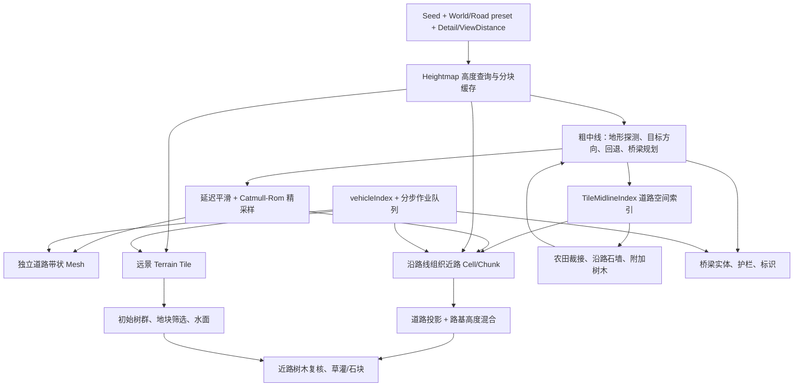

# Slow Roads：道路与周边场景生成源码分析

分析对象：本地 Slow Roads v1.0.2 发布构建；分析日期：2026-10-27。

本报告只解释原版生成算法、数据与调用关系，不做 Unity 实现或视觉还原差异比较。以 Hills 为完整主线，补充 California、OffWorld 分支。渲染仅在它影响几何数据、LOD 切换、实例生命周期时提及，不展开材质、光照、车辆。

## 0. 证据范围与阅读约定

- 使用 `C:/Users/ruze/OneDrive/Desktop/Slow Roads/extracted_correct/build/_app/immutable/chunks` 的发布 JS；核心原始文件此前已与 `resources/app.asar` 核验。不要混用 `extracted`：该目录存在解包偏移问题。
- 这是压缩后的发布代码，不是带完整命名与注释的开发仓库。下面的“道路生成器”“地块管理器”等是根据行为赋予的解释性名称；`Se`、`Pl`、`Ka` 等是构建中实际符号。
- 本次另存了六个模块的相关代码摘录，见 `SourceAtlas/`，不依赖临时目录。每行的 `Lxxxxx` 是本次完整格式化模块的行号；点击报告链接可直接到摘录位置。
- 六个模块均做了 Acorn AST 等价校验：忽略位置与字面量书写形式，将同运算符逻辑表达式的结合关系展开后比较。全部通过。原始 SHA-256、摘录范围见 `source-manifest.json`。
- 以下是静态控制流与公式分析，没有运行完整 Electron 场景或做多 seed 统计。只将实际调用到的代码作为主流程；配置字段存在，不等于该功能生效。

## 1. 整体架构：高度场在先，道路组织近场内容

核心关系不是“把整张地形先烘焙完，再放一条道路”，而是：**可随坐标查询的高度场 → 增量道路中线 → 沿中线生成并调度局部地形与场景内容**。高度场本身不被道路直接写回；道路周边网格在采样时做高度混合。



图中农田回写中线的是 `dswl/dswr`、阴影等**附属标记**，不是重新规划路线。路面、地形、树木、墙体使用同一条中线和地面查询接口，所以能保持空间一致。

Hills 的入口为 `Ni.initialise()`：建立 `Pl` 高度图、`Wa` 树图和 `B7` 中线生成器，向作业队列依次加入 `Midline.load`、`OnMidlineReady`、`Scene.initialiseLoad`、`OnSceneReady`。`initialiseLoad()` 再启动道路索引、地形、墙体、桥梁、路边对象和路面。

运行阶段 `Ni.updateLive()` 调用中线更新、道路索引更新、地形更新、路面更新、墙体更新；跨过新的道路节点时还推进桥梁、标识与路边对象。见 [场景初始化](E:/UnityProject/Unity6/SlowRoads/Docs/ReverseEngineering/SceneArchitecture/SourceAtlas/Settings.source.txt:9170)、[运行更新链](E:/UnityProject/Unity6/SlowRoads/Docs/ReverseEngineering/SceneArchitecture/SourceAtlas/Settings.source.txt:9522)。

### 1.1 模块与关键函数职责

| 模块／实际符号 | 关键函数 | 生成职责 |
|---|---|---|
| Dev / `oe` | `getTile/cacheTile/pruneCache/setLayers` | 高度图缓存、分层代际切换与回收 |
| Hills / `Pl` | `generateTile/getXZ/lerpHeight` | 基础丘陵高度场；同一算法也用于树密度场 |
| Dev / `Se` | `extendMidline/testForBridge/smoothHeight/extendFine/update` | 通用路线增长、约束、回退、桥梁规划与精采样 |
| Settings / `B7` | `extendMidline/extendFine/updateMarkings/smoothHeight` | Hills 中线附加路基过渡、树影、标线与横坡信息 |
| Dev / `D`；Hills / `Nl` | `initGeneration/genNext/finalise` | 道路带状网格与道路属性 |
| Settings / `xi` | `init/load/update` | 三个道路段复用与前向生成 |
| Settings / `Ca`（实例 `J0`） | `getClosestNodeForTile/isCloseToRoad` | 将道路链表映射到地形 tile，缩小空间查询范围 |
| Settings / `Ma`；`si` | `update/stageCurrentChunk/registerOverlapCell` | 远景 tile 和近路 chunk 两套流式管理 |
| Settings / `Dt`；`i7` | `genHeights0/1/genNormals0/1/genCustom0` | 远景地形、树群、农田、水面 |
| Settings / `U`；`s0`（别名 `q4`） | `getCompleteHeight/loadPositions/loadTrees/loadCustom1` | 近路地形重建、树木复核、草灌生成 |
| Settings / `Wa` | `getDensityAt/getTreesAt/getArrangement` | 树密度、种类、群组布局与变体选择 |
| Settings / `Ra/Ea/Ka` | `checkFieldInclusions/loadNextField` | 地块模板共享、筛选、道路裁接、围墙与附加树木 |
| Settings / `G7`、`J9` | `updateGeneration/update/initBridge` | 墙体规则执行、桥梁实体构建与生命周期 |

## 2. 核心数据结构与坐标约定

| 数据 | 重要字段 | 含义与使用方式 |
|---|---|---|
| 中线全局状态 | `head/tail/fineTail/vehicleNode/vehicleIndex/generation` | 已保留链首、可增长链尾、已精采样边界和当前位置 |
| 粗节点 | `i,p,a,n,da,t,g,gf,gfa,h,d,prev,next` | 索引、位置、航向、XZ 侧向、转角、控制量、归一化坡度、平滑修正等；字段须按写入函数解释 |
| 节点附加属性 | `bridge,blend,bank,shadowLeft/Right,dswl/dswr,lWallDist/rWallDist,chunk,fs` | 桥段、路基混合、横坡、树影、石墙位置、碰撞侧界、所属近路块、精采样段数 |
| 精节点 | `p,n,prevFine,nextFine,prev,next` | `prevFine/nextFine` 是精链；中间精节点的 `prev/next` 指向包围它的粗节点，通常没有粗索引 `i` |
| 道路投影结果 | `n,nf,t,t1,d,s,y,rd,w,...` | 粗／精参考节点、段内参数、横向距离、左右侧、投影路高；混合函数还会写入派生量 |
| 高度缓存 | `cache/cacheLayer/cacheAccess/curLayer` | tile 坐标索引、代际、访问衰减；并非保存整个世界的稠密高度数组 |
| 道路空间段 | `{head,tail,mid?,bounds}` | 某个地形 tile 邻域内的一段道路链，附包围盒和可选中点 |
| Terrain Tile | `heights,geo,overlaps,status,lastSeenIndex` | 规则网格底图；粗细索引、近路重叠标记、流式生命周期 |
| Cell / Chunk | `cellMap/cellList/innerCellList,closestNode,closeNodes,corner heights,bufferIndexEntry` | 沿道路收集的小格子；一个 chunk 是若干 cell 的合并缓冲，不等于正方形 tile |
| 树群记录 | `a,c,y,s,v,i,x,d` | 布局索引、数量、类型、尺度、变体、imposter 索引、额外树列表、密度 |
| 农田模板 | `nodes,fields,walls` | 点、地块多边形拓扑、共享边；地块有 `center/radius/bounds` |
| 农田实例元数据 | `drawnFields/drawnWalls/nodeHeights/nodeTreeDensities/nodeMidlineLookup/members` | 跨地形 tile 共享生成记录，防止重复边界；引用归零释放 |

生成坐标使用世界 XZ 平面和 Y 高程；网格通常以当前 tile/chunk/road segment 的世界 XZ 原点转为局部顶点。方向 `n` 是平面侧向，不是路面法线。大量函数返回或修改模块级临时对象，不能把这些返回值当成独立不可变快照长期缓存。

## 3. 道路生成算法

### 3.1 基础高度图：Hills 并非通用 Perlin fBm

`Pl` 继承高度图缓存基类。每个高度图 tile 默认覆盖 3000 世界单位；这与可见 Terrain Tile 的 240–2500 大小是两套概念。

1. 用 `seed + '#' + curLayer[符号侧] + '#' + tileX + '#' + tileZ` 初始化 Alea。
2. 每个细节层按 `layerResolutions[k] = m` 建立 `m×m` 个径向控制点，中心是 `((i+0.5)/m,(j+0.5)/m)`，支持半径 `r=1/m`。
3. 控制点随机值 `u∈[-1,1]`。开启 `squared` 时实际映射为 `sign(u)·4u²(1-|u|)`，不是简单的 `u²`。
4. 高度振幅约为 `scale · (resolution/m) · depthHeightFactor^(k+1) · tileScale`。其中 `tileScale=1+random·tileScaleRandom-tileScaleRandom/2`。
5. 查询 `getXZ(x,z)` 时，每层只累加邻近四个控制点的核贡献，越界点从相邻 tile 取。径向核以**距离平方**归一化：`q=distance²/r²`，`K(q)=1-(6q⁵-15q⁴+10q³)`，仅 `q<1` 有贡献。
6. 启用 `temper` 后，后续层振幅再乘 `clamp((已累计高度+offset+temperBase)/temperBelow, temperMin,1)`；最后加 `offset`。

因此它是多尺度、紧支撑径向核叠加，并带依赖当前累计高度的调制；不能直接替换成“几层 Perlin 相加”来解释。`Pl.getCurvature()` 当前直接返回 0，不能把 Hills 的 `curvature` 缓冲理解成已计算的真实地貌曲率。见 [Hills 高度图实现](E:/UnityProject/Unity6/SlowRoads/Docs/ReverseEngineering/SceneArchitecture/SourceAtlas/Hills.source.txt:1264)。

### 3.2 粗中线：地形探针驱动的增量寻路

`Se.extendMidline()` 每次尝试增长一个节点。整体是局部启发式控制加回退，没有发现作为主生成器使用的 A* 网格搜索或全局最短路求解。

探测当前高程 `HA`，以及航向两侧 `±feelAng`、前方 `feelDist` 的 `HL/HR`。靠水时探测距离乘 `1+waterFactor`。计算：

```text
HA = max(heightmap(current), minElev)
Havg = (HL + HR) / 2
Hdiff = (HR - HL) / 2
bT = Hdiff == 0 ? 0 : clamp((Havg - HA) / Hdiff, -1, 1)
gLat = ((HL - HR) / feelDist) / adjustedMaxGrad
gLon = ((Havg - HA) / feelDist) / adjustedMaxGrad
```

`bT` 表示本次转向控制量。随后依次处理：

1. 根据左右坡度求允许的控制区间 `minT/maxT`，约束过陡方向。
2. 限制相对 `prevT` 的变化；`maxTurnDelta` 是这里的控制量变化约束，不宜直接当成“每节点最大角度”。写入新航向前还会以 `smoothFactor` 缩放转向控制量，并根据 `antiWeight` 调整该缩放的权重。
3. 缓坡上抑制地形转向，陡坡上更强地沿等高线方向调整。
4. `byWater/waterFactor` 抑制转入低洼水域，降低目标方向对局部避水的覆盖。
5. 叠加目标方向：通常沿大尺度环带的切向行进，偏离内外半径后加入径向修正。
6. 叠加 `antiTarget`：失败路线终点形成排斥区，避免回退后再次走进同一死路。
7. 判断转弯累计、方向溢出和桥梁候选；需要时回退，否则按航向前进 `nodeSpacing` 并查询高程。
8. 写入节点、连接 `prev/next`、推进平滑窗口。

名义间距为 10；后续平面平滑、曲线采样会改变实际段长，所以不能假设最终顶点等距。见 [粗中线主函数](E:/UnityProject/Unity6/SlowRoads/Docs/ReverseEngineering/SceneArchitecture/SourceAtlas/Dev.source.txt:1426)。

### 3.3 回退、重启与“无限”生成

`turnTrackers` 在 15、30、60、120 个节点等不同窗口内累计转角；默认阈值约 3.3、3.3、3.4、3.6 弧度，并有与目标方向相关的容忍修正。它与 `targetOverflow/accumulatedOverflow`、纵坡限制及自定义条件一起触发回退。

回退不仅删除节点，也恢复转向、窗口、桥状态、高度图代际和平滑相关状态；反复失败会扩大回退范围或重启。桥方案可以作为回退后的替代路线。不能从该逻辑推导出“绝对不自交”：主机制是局部方向约束和失败重试，并非对所有历史路段做完备几何相交证明。

道路围绕大尺度环带延伸；高度图还会经 `checkUpdateTailHeightmap/checkUpdateHeadHeightmap` 和 `setLayers/incrementLayer` 更新代际。同坐标未来可使用不同代际的高度场；世界不是一个永远不变的、一次生成好的闭环。

`update()` 以节点索引控制预生成、精采样和旧节点回收。常量粗路前向目标为约 2500 节点，精线还受距可变粗尾约 1900 节点的限制。`fineHorizon` 来自视距档位。初始化由作业队列反复调用 `load()` 完成，运行时渐进推进。见 [高度图代际推进](E:/UnityProject/Unity6/SlowRoads/Docs/ReverseEngineering/SceneArchitecture/SourceAtlas/Dev.source.txt:1175)、[中线运行更新](E:/UnityProject/Unity6/SlowRoads/Docs/ReverseEngineering/SceneArchitecture/SourceAtlas/Dev.source.txt:2187)。

### 3.4 桥梁规划和实体生成是两层

- **规划层：** `testForBridge()` 向前、侧向或组合方向搜索对岸，`checkBridgeQuality()` 用跨度、高差、水域情况、横向条件与目标方向评价候选。必要时回退到 `spawnNode`，进入 approach/span/dismount 状态，控制道路高程并标记 `bridge`。
- **实体层：** `J9` 前向扫描已标记的连续桥节点，构造 `ii`；`ii.load()` 分步产生桥面、桥墩、桥拱，`makeDeckVerts/makePylon/makeArch` 分工明确。近远 LOD 使用不同细分索引；弧线轮廓来自随细节档位变化的预设采样表。
- 桥侧墙由独立墙体生成器 `$7` 消费同一 `bridge` 标记。
- 路基混合会在桥中段保留桥下原地形，在入口、出口逐渐接回路面，避免把桥下水域整体填平。

见 [桥梁候选搜索](E:/UnityProject/Unity6/SlowRoads/Docs/ReverseEngineering/SceneArchitecture/SourceAtlas/Dev.source.txt:1998)、[桥梁实体控制器](E:/UnityProject/Unity6/SlowRoads/Docs/ReverseEngineering/SceneArchitecture/SourceAtlas/Settings.source.txt:8137)、[桥梁几何](E:/UnityProject/Unity6/SlowRoads/Docs/ReverseEngineering/SceneArchitecture/SourceAtlas/Settings.source.txt:8245)。

### 3.5 延迟平滑与精采样

`smoothHeight()` 在窗口内求平均，先存节点原始高程相对均值的修正 `h`，再随着窗口推进应用到较早节点。它不是对整个已生成数组一次性做均值滤波。窗口中的桥逻辑、起点补偿和回退恢复都属于这个状态机。

当前平面平滑路径使用 `smoothCurvesD()`：计算相邻节点转角均值 `c`，以 `g=(1-clamp(|c|/0.4,0.25,1))·smoothingStrength` 将中心点 XZ 向前后邻点中点靠近。急弯保留更多形态，缓弯收敛更强。其他 `smoothCurvesA/B/C` 虽然存在，不能因此认为都参与当前流程。

`extendFine()` 取 `[prev,current,next,next.next]` 四点构建 Three.js `CatmullRomCurve3`，使用默认 centripetal 参数化，仅采样全曲线参数 `[1/3,2/3]` 的中间粗段。精采样数量根据前后方向夹角自适应：

```text
先将方向向量的 Y 分量乘 curvatureHeightFactor，再归一化
d = min(dot(previous,current), dot(current,next))
s = floor(10 * sqrt(100 * (1 - max(d,0.99))))
s = clamp 到 minFineSegs…10
```

粗端点复用，内部创建精节点；侧向 `n=(-dz,0,dx)/sqrt(dx²+dz²)` 由前后精点的 XZ 差分获得。**这是曲线参数采样，不是等弧长重采样。** 见 [精中线采样](E:/UnityProject/Unity6/SlowRoads/Docs/ReverseEngineering/SceneArchitecture/SourceAtlas/Dev.source.txt:1378)、[平面与高度平滑](E:/UnityProject/Unity6/SlowRoads/Docs/ReverseEngineering/SceneArchitecture/SourceAtlas/Dev.source.txt:2139)。

### 3.6 道路 Mesh：二维横断面沿精线扫掠

每个精节点只有左右两个路面顶点：

```text
Vleft  = P - Nxz * halfWidth
Vright = P + Nxz * halfWidth
两者 y += 0.02
局部位置再减 segment 原点 (origin.x,0,origin.z)
```

相邻横断面索引 `a,b,c,d` 组成 `(a,b,c)` 与 `(b,d,c)` 两个三角形。宽度是 XZ 横向距离，不是沿三维斜面的弧长；左右顶点共享该截面的 Y。路面法线来自前向切线与负侧向的叉积。不要把路面带本身误读成有路肩、边坡和厚度的体积模型，这些主要由周边地形、墙与桥几何补充。

UV：横向 `u=0/1`；每个名义 10 单位粗区间推进 `Δv=10/(2·halfWidth)`，再均分给内部精节点。纵向不是按照实际曲线长度累积，段间继续使用保存的 UV 相位，并做取模以控制数值。

两套索引共享密集顶点缓冲：原码 **LOD0 是粗索引，LOD1 是精索引**。粗索引直接连接粗节点对应截面。若有 A 个粗区间、细段总数 S，则有效路面顶点约 `2(S+1)`、精三角形 `2S`、粗三角形 `2A`；容量按最多每粗段 10 个细段预留。

`xi` 管理 `prevSeg/curSeg/nextSeg` 三个复用段；下一段分步生成，跨边界后交换职责，近处切换精索引。Hills 的 `Nl` 追加桥、标线、树影等属性；越野样式的可见道路还依赖地形表面的路形处理。

见 [道路几何基类](E:/UnityProject/Unity6/SlowRoads/Docs/ReverseEngineering/SceneArchitecture/SourceAtlas/Dev.source.txt:572)、[三段道路控制器](E:/UnityProject/Unity6/SlowRoads/Docs/ReverseEngineering/SceneArchitecture/SourceAtlas/Settings.source.txt:8883)。

### 3.7 道路参数：默认值与预设覆盖分开看

| 参数组 | 默认／实际来源 | 作用与注意事项 |
|---|---|---|
| 探测 | `feelDist=10, feelAng=0.463` | 两侧前向地形采样 |
| 增长 | `nodeSpacing=10, maxGrad=0.18, maxTurnDelta=0.7` | 名义节点间距、坡度归一化、控制变化；场景 style 会覆盖 |
| 水域 | `minElev=2` | 避水和路线最低高度判据之一；并不修改原始高度图 |
| 桥 | `minBridgeNodes=3,maxBridgeNodes=35,maxBridgeElev=4` | 桥候选与长度约束；部分实现直接用 10 作间距换算 |
| 平滑 | `smoothWindow=7,smoothingStrength=1` | 延迟窗口与平面拉平强度；不能仅凭 `smoothFactor` 字段推导算法 |
| 精采样 | `curvatureHeightFactor=3,minFineSegs=1` | 起伏对细分的权重；style 可将最少细段设为 2 |
| 大尺度方向 | `genRadius=12000,genMinRadius=6000` | 环带方向与半径约束，不是显式道路拓扑网格 |
| Hills 宽度 | single 3.6／7.2；compound lane 3.4／4 | 进入建模的是运行时 halfWidth；如标准复合 k=1 时 halfWidth=3.7，全宽7.4，不能把 laneWidth 当全路宽 |

完整默认配置见 [中线默认参数](E:/UnityProject/Unity6/SlowRoads/Docs/ReverseEngineering/SceneArchitecture/SourceAtlas/Dev.source.txt:827)；Hills world/style 覆盖与图形档位见 [道路预设](E:/UnityProject/Unity6/SlowRoads/Docs/ReverseEngineering/SceneArchitecture/SourceAtlas/Hills.source.txt:7)、[流式与细节预设](E:/UnityProject/Unity6/SlowRoads/Docs/ReverseEngineering/SceneArchitecture/SourceAtlas/Hills.source.txt:323)。JS 对象有重复 key 时最后一项生效，例如某丘陵预设最终 `scale=75,offset=105,layerResolutions=[3,11,5,27],depthHeightFactor=1,temperBelow=250,temperMin=0.7`，不能摘取前面被覆盖的值。

## 4. 道路周边地形：两层网格与局部路基重建

### 4.1 道路空间索引

`Ca.update()` 沿已生成粗线推进，在道路附近的 tile 中注册片段。片段记录首尾、包围盒，较长片段附中点。查询时先做包围盒排除，再用首尾线段／中间折段近似选候选，最后沿链向前或向后搜索更近节点。

这降低了每个地形采样点遍历整个道路历史的成本。`getClosestNodeForTile()` 返回的 `d` 是平方距离；后续投影记录的 `d` 则是横向距离，两个 API 的同名字段不能混为一谈。近路 cell 保存 `closestNode/closeNodes`，可以比较多个路段的投影距离。见 [道路空间索引](E:/UnityProject/Unity6/SlowRoads/Docs/ReverseEngineering/SceneArchitecture/SourceAtlas/Settings.source.txt:952)、[近路高度查询](E:/UnityProject/Unity6/SlowRoads/Docs/ReverseEngineering/SceneArchitecture/SourceAtlas/Settings.source.txt:656)。

### 4.2 远景 Terrain Tile

`Ma` 默认初始化 5×5 个 tile；较内层预升级，外层保留粗网格。`Dt.genHeights0()` 先采样粗格与边界，`genHeights1()` 补充细格；`genNormals0/1()` 用高度差分计算法线。两档共用顶点容量与不同索引区间。

Hills `cellSize=20`，内部细格尺寸 `C=cellSize/2=10`。对于 tile 边长 H，细网格分段数 `F=2·round(H/20)`、每边顶点数 `F+1`。边界保留必要的细采样，避免单纯以大三角形替代边界导致对接问题。

外层地形使用原始高度场，路形主要由后面的近路 chunk 承担。每个 tile 同时保存树群记录、农田管理器、可选水面及 `overlap` 属性。见 [地形流式参数初始化](E:/UnityProject/Unity6/SlowRoads/Docs/ReverseEngineering/SceneArchitecture/SourceAtlas/Settings.source.txt:1160)、[远景高程与法线](E:/UnityProject/Unity6/SlowRoads/Docs/ReverseEngineering/SceneArchitecture/SourceAtlas/Settings.source.txt:1999)。

### 4.3 近路 Cell 与 Chunk

道路 lookahead 每跨过一个 10×10 cell，就把其周围小格加入当前 chunk，并标记内圈。chunk 满或满足切块条件后提交下一阶段。多个 chunk 可以是一条弯曲道路走廊，不是固定方形地形块。

每个 cell 采用 `(cellRes+1)²` 个密集顶点；cellRes 为 10／16／20，越野可以为24。对应 Hills 内格采样间距约 1／0.625／0.5，越野约0.417。

`U.loadPositions()` 的当前路径先对 cell 四角原始高度做双线性插值，再求最近道路精投影，调用场景 `getRoadBlendedHeight`。因此**近路每个密集顶点并非都重新完整查询多层噪声**。局部法线、查询和边界分支可以额外访问高度函数；不能将这简化成所有位置都只插值或都精确采样。

inner cell 可使用精索引；outer cell 保持较粗索引作为过渡。重叠处通过 `registerOverlapCell/registerEdgeOverlap` 将可见时序写入远景 tile 的 `overlap` 数据，用于近路块覆盖和交接。该机制不等同于把整个远景 mesh 的重叠三角形永久删除。

见 [近路格缓冲分配](E:/UnityProject/Unity6/SlowRoads/Docs/ReverseEngineering/SceneArchitecture/SourceAtlas/Settings.source.txt:506)、[道路高度混合入口](E:/UnityProject/Unity6/SlowRoads/Docs/ReverseEngineering/SceneArchitecture/SourceAtlas/Settings.source.txt:656)、[近路位置生成](E:/UnityProject/Unity6/SlowRoads/Docs/ReverseEngineering/SceneArchitecture/SourceAtlas/Settings.source.txt:712)、[重叠管理](E:/UnityProject/Unity6/SlowRoads/Docs/ReverseEngineering/SceneArchitecture/SourceAtlas/Settings.source.txt:1612)。

### 4.4 路基、边坡与越野路形

Hills 的核心函数是 `Ll`（导出为 `getRoadBlendedHeight`）。输入原地形高度 H 和道路投影记录，输出局部调整高程：

1. 在粗节点间插值 `h/gfa/g/blend`，得到局部坡度和平滑信息。
2. 用道路半宽、路肩余量、坡侧修正求有效宽度 w；过渡半径 `rm=yt·(0.4+0.6·blend)`，其中运行时 `yt=20-halfWidth`。
3. 路侧约16单位范围内加入受衰减控制的小尺度扰动；坡侧还可叠加另一噪声。
4. 路面核心区压到投影路高；外侧计算 `t=clamp((distance-w)/rm,0,1)`，通过分段曲线 `roadLerp(t)` 混合回基础地形。
5. `roadLerp(t)` 在约前1/3使用 `1.5t`，后2/3使用 `1-0.5·(1-(t-0.3333)/0.6667)²`，形成非线性的边坡过渡。
6. 越野样式额外处理中央隆起、边缘隆起、小幅高程噪声和 `bank` 横坡；道路距离本身也有扰动。
7. 连续桥段内提高基础地形权重，入口／出口按段参数接合；必要时处理桥侧高地，保留桥下空间。

主式可概括为 `Hout=Hterrain·α+Hroad·(1-α)`，但 α、Hterrain、Hroad 都经过上述分支，不能只用一个固定宽度 smoothstep 代表实际算法。函数会修改投影记录，例如 `d/y/rd/w`，下游草灌数据也会受此影响。见 [完整路基混合函数](E:/UnityProject/Unity6/SlowRoads/Docs/ReverseEngineering/SceneArchitecture/SourceAtlas/Hills.source.txt:834)。

## 5. 植被：密度场、预设树群与近路筛选

### 5.1 树密度与树群布局

`Wa.init()` 建一个独立 `Pl` 密度图，以及用于树种区分的梯度噪声 `typeMap`。两图与世界代际同步，但各有配置。Hills 密度：

```text
F = (Auto ? 0.5 + min(0.5,detail/5) : (treeDensity-1)/3) * 0.8
D(x,z) = (1 - clamp(treeMap(x,z) + 1 - F,0,1)) * F
```

`getTreesAt()` 用 `(D-0.001)·3` 加随机舍入确定群内数量，选择预设 arrangement、树种和变体。高细节还平均四个偏移±10位置的密度，作为邻域密度。arrangement 是预存的局部位置和旋转／尺度组合，而非运行时对每株做 Poisson-disc 或任意随机坐标搜索。

`i7.customGenNormals0()` 按20单位粗采样区域拆成四个10单位群组，选择树群，查询初始高度、按群密度做下沉，写入 `treeMap[cellX][cellZ]` 并生成远景树实例。Hills 关键筛选：地面法线 Y 小于0.7不生成该点树群；初始树高需大于2。见 [树密度与布局选择](E:/UnityProject/Unity6/SlowRoads/Docs/ReverseEngineering/SceneArchitecture/SourceAtlas/Settings.source.txt:2872)、[初始树群写入](E:/UnityProject/Unity6/SlowRoads/Docs/ReverseEngineering/SceneArchitecture/SourceAtlas/Settings.source.txt:4143)。

### 5.2 近路树木复核与实例切换

`s0.customCellInit()` 将近路 cell 关联到所属 tile 的树群记录；`loadTrees()` 对每株候选在**已混合的地形网格**上查询：

- 地面高度至少2。
- 道路边缘距离至少1.8。
- 地面法线 Y 至少0.7；部分大冠树按尺度追加离路安全距离。
- 无效树隐藏远景实例；有效树修正高度并记录实例参数。
- 近处升级时注册三维树并调整原 imposter；降级时移除三维实例并恢复对应远景表现。

因此近景并不是另随机生成一套树，而是消费、校正和切换同一套候选。农田边界加的树存在记录的 `x` 列表中，也进入这一生命周期。见 [近路树木复核](E:/UnityProject/Unity6/SlowRoads/Docs/ReverseEngineering/SceneArchitecture/SourceAtlas/Settings.source.txt:5375)、[树木升级与回收](E:/UnityProject/Unity6/SlowRoads/Docs/ReverseEngineering/SceneArchitecture/SourceAtlas/Settings.source.txt:5339)。

### 5.3 草和灌木

`s0.loadCustom1()` 按细网格行分批采样；inner cell 密集遍历，outer cell 隔点采样。使用已有地面高度、道路距离、法线和双线性树密度，叠加循环随机表产生位置扰动、旋转、尺度和埋入量。

| 规则 | Hills 行为 |
|---|---|
| 基础剔除 | 硬路面边缘外约0.1内跳过；越野按样式调整；高度低于1.5跳过；法线Y加小随机量小于0.7跳过 |
| 灌木优先 | 先算灌木概率，成功则该采样点不再生成普通草 |
| 林下与墙边 | 树密度增加灌木概率；已有墙侧、近墙带有单独增强规则 |
| 高地灌木 | 高度>100且稀树时用200与1000尺度噪声选择特殊灌木区域；高度>200继续调强 |
| 概率非线性 | 对基础 bushProb 平方，再乘草密度设置的平方 |
| 离路衰减 | 路边过近抑制；远离道路后下降、下沉或剔除；阈值随草 margin 配置变化 |
| 草丛 | 按全局密度抽样；树密度高、离路较远时进一步减少；远处调整尺寸与下沉 |
| 放置 | 在采样格内抖动，按法线近似修正偏移后的高度；不是每株重新做高成本全图查询 |

草／灌木实例携带 `downgradeIndex`，由环形实例控制器随道路进度回收。生成本身是 JS/CPU 的分步网格遍历；源码没有把它实现成 GPU 生成算法。见 [草灌完整规则](E:/UnityProject/Unity6/SlowRoads/Docs/ReverseEngineering/SceneArchitecture/SourceAtlas/Settings.source.txt:5428)、[实例生命周期](E:/UnityProject/Unity6/SlowRoads/Docs/ReverseEngineering/SceneArchitecture/SourceAtlas/Settings.source.txt:4923)。

## 6. 农田、地块边界与路边石墙

### 6.1 模板拓扑与跨块共享

`y9` 是固定地块点和多边形表；`Da(fieldMapScale)` 缩放成世界模板，创建 `nodes/fields/walls`，并尝试按有序端点对共享边。每个 field 计算包围盒、中心和半径。`Ra/Ea` 再把此模板平铺到世界坐标，并共享绘制状态、节点高程、树密度和道路投影缓存。

这不是 Voronoi、道路网络分割或地块成长求解；地形决定“模板中的哪些地块出现”，道路决定“边界如何接到道路”。`members` 管理多个 Terrain Tile 对同一个 Field Tile 的引用。见 [模板构造](E:/UnityProject/Unity6/SlowRoads/Docs/ReverseEngineering/SceneArchitecture/SourceAtlas/Settings.source.txt:2292)、[Field Tile 共享状态](E:/UnityProject/Unity6/SlowRoads/Docs/ReverseEngineering/SceneArchitecture/SourceAtlas/Settings.source.txt:2337)。

### 6.2 候选筛选

`Ka.checkFieldInclusions()` 先要求地块中心处树密度不大于0.15，再采样模板顶点高程：

```text
minHeight >= 15
maxHeight <= 220
grade = (maxHeight-minHeight)/field.radius <= 0.7
heightQuality = 1 - (minHeight+maxHeight)/2/220
gradeQuality = 1 - grade/0.7
prob = (noiseQuality + (heightQuality+gradeQuality)/2)/2
prob >= 0.5 才入候选
```

这里 `prob` 是一个确定性质量值与阈值的比较，不是再调用随机数进行伯努利抽样。见 [农田筛选函数](E:/UnityProject/Unity6/SlowRoads/Docs/ReverseEngineering/SceneArchitecture/SourceAtlas/Settings.source.txt:3204)。

### 6.3 道路裁接、边界生成和回写

`loadNextField()` 查询地块附近道路，确定地块位于道路哪侧，检查每个模板顶点的侧向与距离。路侧15单位以内或另一侧的点视为需要裁掉；坡度不合适、道路多次进出、从同一侧进出等复杂情况跳过。

需要裁接的边界端点移到道路旁，再用 `getRoadsideHeight()` 贴合已修整地形。沿墙长度增加中间采样：远离道路约20单位一段、近路约8单位、与路相交的精细段约2单位。实际墙几何仍有柱体、树木和贴地规则。

地块与道路相交时，将沿路线的边界写为 `dswl/dswr`，让道路墙体生成器 `K7` 生成对应石墙；同时按高度／密度追加边界树，记录到 tile 树群，更新节点树影。整块未碰道路、未跨当前地形块边界且启用着色时，按10单位步长写 `fieldCol`。

新道路进入已生成 Field Tile 后，`checkRegenerate()` 通过道路索引尾节点变化检测重新裁接，删除旧附加树后再生成。因此农田与道路并非完全独立的单次任务。见 [农田道路裁接](E:/UnityProject/Unity6/SlowRoads/Docs/ReverseEngineering/SceneArchitecture/SourceAtlas/Settings.source.txt:3240)、[沿路边界回写](E:/UnityProject/Unity6/SlowRoads/Docs/ReverseEngineering/SceneArchitecture/SourceAtlas/Settings.source.txt:3542)、[地块更新条件](E:/UnityProject/Unity6/SlowRoads/Docs/ReverseEngineering/SceneArchitecture/SourceAtlas/Settings.source.txt:3145)。

## 7. 水域与湖泊外观的来源

Hills 当前调用链中，没有发现独立的湖泊中心／半径规划、汇水盆地识别、河网、侵蚀或不同湖面水位求解器。可直接确认的机制是：

1. 基础高度场自然产生低于0的凹地。
2. `i7.customGenHeights0()` 发现采样高度 `<0`，设置 `hasSea=true`。
3. `makeSea()` 为该 tile 创建覆盖整块 XZ 的平面，Y保持0。
4. `genCustom0()` 按水面格点查询地形高度，写入名为 `depth` 的属性；这个属性存的是采样地形高程，不应直接称为已经取正值的“水深”。
5. 在有水 tile 中启用水面；地形高于水面的部分由几何遮挡与水面表达共同形成岸线。

水面分段数 `max(1,floor(detailSeaRes·tileSize/20))`，`detailSeaRes` 为0.2–0.5。道路避水与桥梁在同一0海平面及最低道路高度体系下工作。

**解释：** 被地形围住的低洼区域可以呈现“湖”的外观，但在这条生成链中仍是统一海平面下的低地，不是独立湖泊实体。高海拔湖泊不应从这些代码中臆测出来。California 同样使用 tile 水面，另由海岸高度场塑造大尺度海陆分布。见 [水面网格](E:/UnityProject/Unity6/SlowRoads/Docs/ReverseEngineering/SceneArchitecture/SourceAtlas/Settings.source.txt:4114)、[水面属性生成](E:/UnityProject/Unity6/SlowRoads/Docs/ReverseEngineering/SceneArchitecture/SourceAtlas/Settings.source.txt:4262)。

## 8. 护栏、海墙、桥侧墙与其他道路附属物

`G7` 维护左右侧墙段、生成游标、对象池与待显示队列。生成器按路况选择：

| 生成器 | 触发依据 | 输出 |
|---|---|---|
| `$7` | 连续 `bridge` 标记 | 桥侧墙 |
| `q7` | 低海拔、非桥、侧向下坡或高程修正满足阈值 | 海墙 |
| `Z7` | 高于海墙阈值，侧向坡度或转弯／高程条件达到危险阈值 | 护栏或栅栏，开始和维持阈值不同 |
| `K7` | 农田写入 `dswl/dswr` | 沿路石墙 |

段记录 `I2` 保留起止节点、类型、偏移距离、前后连续标记；相邻同类型段连接时保持连续状态，较长段按最大长度切分。起止条件存在滞回式差异，减少边界频繁开关。`lWallDist/rWallDist` 也供地面／侧界查询使用。

`E7` 是路边对象池，`_9` 是标识控制器，沿道路 lookahead 与车辆索引推进放置和回收；它们消费既有中线，不主导道路或地形形成。见 [墙体调度](E:/UnityProject/Unity6/SlowRoads/Docs/ReverseEngineering/SceneArchitecture/SourceAtlas/Settings.source.txt:6405)、[护栏规则](E:/UnityProject/Unity6/SlowRoads/Docs/ReverseEngineering/SceneArchitecture/SourceAtlas/Settings.source.txt:7023)、[海墙桥墙石墙规则](E:/UnityProject/Unity6/SlowRoads/Docs/ReverseEngineering/SceneArchitecture/SourceAtlas/Settings.source.txt:7317)、[路边对象与标识](E:/UnityProject/Unity6/SlowRoads/Docs/ReverseEngineering/SceneArchitecture/SourceAtlas/Settings.source.txt:5592)。

## 9. California 与 OffWorld 的场景分支

### 9.1 California

`vM` 仍接入共用地形流式框架，但传入独立 `Yr/sn/Ds/WD/ds` 等实现。

- **海岸高度场 `Yr`：** 保留多层径向控制点，叠加 `coastRadius/coastMargin` 环形海陆梯度。坐标半径加 deviation noise；海侧抑制噪声，陆侧按分段函数调整振幅和基底高度。可启用 distortion 改变采样坐标。默认海岸半径约12000、过渡半宽700。核函数也不同：最低层用 `(1-distance/radius)²`，较高层用 `1-distance²/radius²`。
- **中线 `sn`：** 初始姿态沿某射线扩展水陆端点，再二分寻找约5–40高程的海岸起点；重启会改变射线角度。之后沿用通用粗线状态机，但采用专属转弯窗口，并关闭 emergency bridge 和 lateral bridge 搜索。
- **树图 `cs`：** 不使用 Hills 那条简单反密度公式。它组合重复噪声、200–600高程衰减、径向40单位高度差、离海岸半径的抑制，再乘密度设置。
- **近路草灌 `ds`：** 基础离路阈值约2，灌木候选常要求距离>3、高程>4；用海拔和两种噪声选择聚集区域、变体和尺度。部分分支直接使用 `Math.random()`，所以不能声称整套植被仅凭 world seed 完全逐实例确定。
- **地块：** 此处 `WD` 没有 Hills `Ka` 农田管理链，墙体列表也没有 Hills 的 Drystone/Fence 路径；不要将 Hills 地块规则当作全场景共用。

见 [California 高度场](E:/UnityProject/Unity6/SlowRoads/Docs/ReverseEngineering/SceneArchitecture/SourceAtlas/Cali.source.txt:483)、[California 树图](E:/UnityProject/Unity6/SlowRoads/Docs/ReverseEngineering/SceneArchitecture/SourceAtlas/Cali.source.txt:1412)、[California 起点与道路](E:/UnityProject/Unity6/SlowRoads/Docs/ReverseEngineering/SceneArchitecture/SourceAtlas/Cali.source.txt:1560)、[California 草灌](E:/UnityProject/Unity6/SlowRoads/Docs/ReverseEngineering/SceneArchitecture/SourceAtlas/Scenes.source.txt:2398)、[California 地形装配](E:/UnityProject/Unity6/SlowRoads/Docs/ReverseEngineering/SceneArchitecture/SourceAtlas/Scenes.source.txt:3595)。

### 9.2 OffWorld

- `Oc` 使用 `Qd` 高度图与 `pw` 中线；基础地形是分层梯度噪声，可开启 compound（后一层振幅受已有高度影响）、squared，再叠加撞击坑。
- `cacheTileCraters()` 按 seed、代际和 tile 坐标缓存坑；各层以 `(layer+1)·2` 划格，概率控制尝试数量，在格内产生偏移中心、半径和负深度。同格后来的记录可以覆盖此前候选，不是无重叠泊松采样。
- `getXZ()` 用径向函数形成外缘抬升与内部凹陷，并压低坑内高频噪声，再加到地形上。
- 该场景道路形状主要进入地形混合／道路属性，没有 Hills/California 的独立道路初始化链。
- 近路 `Tl.loadCustom1()` 散布的是石块：离路约0.5–20，按曲率、坡度和距离剔除；坡度指标>0.1跳过，位置、旋转、尺度随机化并埋入地面。这里不应套用树林／草地算法。

见 [OffWorld 高度与撞击坑](E:/UnityProject/Unity6/SlowRoads/Docs/ReverseEngineering/SceneArchitecture/SourceAtlas/Scenes.source.txt:479)、[近路石块](E:/UnityProject/Unity6/SlowRoads/Docs/ReverseEngineering/SceneArchitecture/SourceAtlas/Scenes.source.txt:813)、[OffWorld 场景装配](E:/UnityProject/Unity6/SlowRoads/Docs/ReverseEngineering/SceneArchitecture/SourceAtlas/Scenes.source.txt:1332)。

## 10. 生成参数与调度尺度

Hills 主要图形档位不是只改变渲染距离，也改变生成批量、采样密度和内容数量：

| 参数 | 六档视距／五档细节值 | 单位／含义 |
|---|---|---|
| Terrain tileSize | 240,480,840,1500,2000,2500 | 世界长度；高度图缓存 tile 仍是另一套3000尺度 |
| roadNodes | 25,25,30,35,42,50 | 单道路段粗区间规模 |
| fineHorizon | 200,300,400,500,600,600 | 道路节点数量 |
| lod1Horizon | 13,16,19,22,25,28 | 沿道路节点索引的近场时序参数 |
| bridgeLookahead | 50,90,160,200,300,300 | 桥实体前向扫描节点 |
| fieldMapScale | 700,800,1000,1000,1000,1000 | 农田模板世界尺度 |
| heightmapMaxCached | 12,16,20,28,40,40 | 高度图缓存限额 |
| cellRes | 10,16,20,20,20 | 每个10单位近路格的细分；越野另设24 |
| grass margin | 0,16,20,24,28 | 草的离路范围参数 |
| grass density | 0,0.5,0.65,0.75,0.85 | 用户 grassDensity 非 Auto 时另行覆盖 |
| fields | 最低档关闭，其余开启 | fieldCol／boundary 另有独立档位开关 |

`Ma.update()` 根据路线 lookahead 的 tile/cell 越界创建 `stage/spawn/upgrade/downgrade/retire` 队列；位置生成、法线、树群、水面等函数常每次只处理一行或一个 cell，通过返回布尔值表示作业完成。chunk 还必须等待父 tile 已准备好。

流式生命周期大致为 `Dead → Staging → Staged → Live → Retired/Repooling`。回收检查道路未来是否仍会经过这个 tile，不能只按“落到车后方”立即销毁；道路靠近旧区域时，仍可保留或重新使用相关数据。见 [流式更新与回收](E:/UnityProject/Unity6/SlowRoads/Docs/ReverseEngineering/SceneArchitecture/SourceAtlas/Settings.source.txt:1425)。

## 11. 阅读源码时需要保留的实现细节

这些是源码事实与研究注意点，不是还原差异清单，也未在本次修复：

1. **随机性分层。** 高度图是坐标／seed／代际决定；`QuickRand` 则预计算101等有限长度随机序列循环消费，调用顺序影响树群、草灌等细节；California 还有直接 `Math.random()`。可复现研究应同时固定配置、代际、调用与调度顺序。见 [循环随机表](E:/UnityProject/Unity6/SlowRoads/Docs/ReverseEngineering/SceneArchitecture/SourceAtlas/Rand.source.txt:12)。
2. **参数名不总是数学语义。** `squared` 的真实函数、`d` 是否平方距离、`g` 是否归一化坡度、`h` 是否平滑修正，都必须从赋值点判断。
3. **生成模块存在共享可变全局。** 路宽、tileSize、缓冲尺度及临时结构在模块级更新；不能直接假设同一套模块可并行生成多个独立世界。
4. **有实际可见的边缘实现问题。** 如中线 `roadSinkFacotr` 拼写与正常字段不一致；`Dt.genHeights1()` 的 `this.genRow & !1` 实际恒为0；`Da()` 对共享边用真假判断会把索引0当作不存在。这些应按实际 JS 行为阅读，不能悄悄替换成看似合理的伪代码。
5. **部分阈值代码反直觉。** `Ka.getTreeDensity()` 在150–300高度区间使用 `(height-150)/150`，不能解释成常见的线性海拔衰减。California 某距离区间也有类似应照公式记录的分支。
6. **局部近似不代表全局求解。** 道路索引先做片段近似再局部搜寻；地块裁接包含拒绝复杂相交的规则；水域只由海平面和地形决定。源码没有证明全局无交叉、精确水文或任意复杂地块裁切。

## 12. 后续研究的建议顺序与接口边界

按数据依赖研究最容易保留原版行为：

1. **先固定高度查询接口。** 单测固定 seed/代际/坐标的 `getXZ`，再验证跨 tile 边界与缓存淘汰后重建。
2. **独立记录粗中线状态。** 输出 `i,p,a,t,g,gf,h,bridge` 以及回退原因；把规划、平滑、精采样分开观察。
3. **验证道路投影与路基混合。** 选直线、急弯、陡坡、桥端的横断面，比较原高程、投影路高、混合权重和最终高程。
4. **接通 tile/cell/chunk 关系。** 重点验证内外格交界、overlap 时序和路线再接近旧区域时的缓存更新。
5. **再逐层加入内容。** 先树群候选与近路复核，再草灌／石块，再农田与墙体回写，最后桥梁实体及道路附属物。

可作为后续模块边界的核心输入输出是：`HeightQuery(x,z,layer)`、`MidlineNode`、`RoadProjection(x,z)`、`BlendHeight(rawHeight,projection)`、`CellSurfaceQuery(x,z)` 和 `PlacementRecord`。这些名称是研究用接口概括，不是声称原代码已经具备如此解耦的类设计。

本次只增加分析报告、源码摘录和校验清单；未修改原游戏代码或 Unity 的 Assets、Packages、ProjectSettings。
